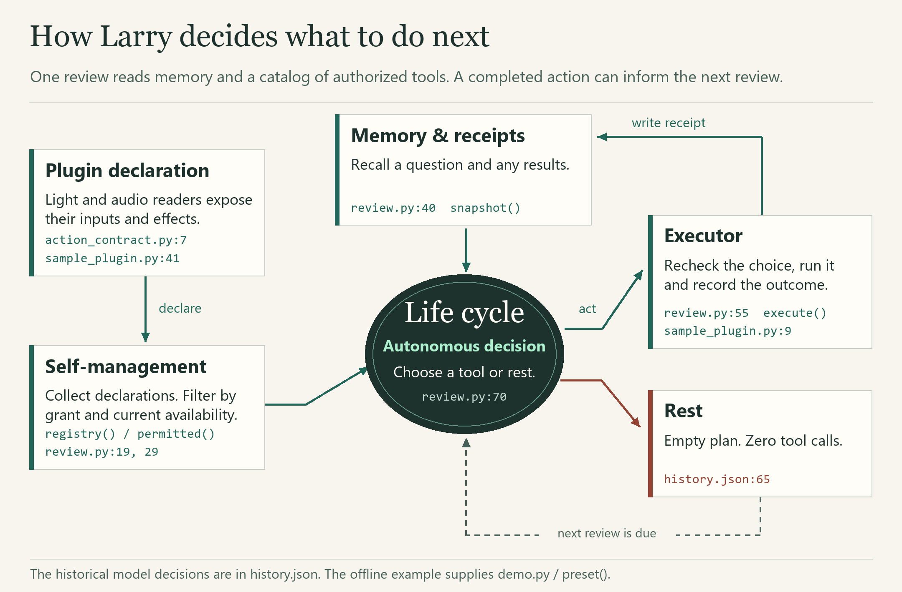
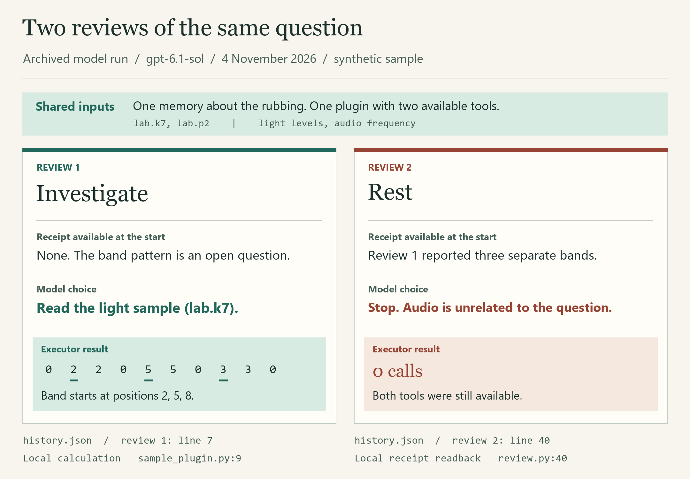

# Larry V2 · 記憶を手がかりに行動を選ぶデスクトップコンパニオン

[English](README.md) · 日本語 · [简体中文](README.zh-CN.md)

ラリーは Windows のデスクトップで暮らすキャラクターです。会話が途切れた後も、以前気になったことを自分から調べられます。ある実験でラリーが覚えていたのは、窓飾りの切り紙から取った拓本のことでした。紙に透ける明るい筋は、つながっているのか、何本かに分かれているのか。新たに登録されたプラグインで光と音を測れると知り、ラリーは光を選びました。次の回も両方を使えましたが、今度は休みました。**二度の判断の間に加わった手がかりは、光の測定結果が一件だけでした。**

| ふだんの姿 | 本を手に取る | 考え込む |
| :---: | :---: | :---: |
|  |  |  |

*検証用の Windows 環境で実際に表示された三つの姿です。本を持つのは画面上のしぐさです。何をどこまで読めたかは、資料を開いたツールが別に記録します。*

**このリポジトリで動かせるもの**は、判断の仕組みを切り出した Python のサンプルです。構成図と実際のモデルによる判断記録も収録しています。デスクトップアプリやアカウント連携を含む稼働版の使い心地は下の表で紹介します。サンプルは Python 3.10 以降の標準ライブラリで動きます。[手元で試す](#手元で試す) · [ライフサイクルを読む](#ライフサイクル) · [二度の判断を比べる](#ラリーが二回目に休んだ理由)

## ラリーと過ごす一日

| 稼働版でできること | 実際の振る舞い |
| --- | --- |
| 別の場所で話の続きをする | デスクトップで切り出した話題を QQ で続けられます。どちらの会話も同じ記憶に入り、発言した場所と時刻が残ります。後から考えが変わったことも、その順序でたどれます。 |
| 気になる話に自分から戻る | 新着メッセージがなくても、次の判断時刻が来るとラリーは記憶を振り返ります。疑問を調べる、ユーザーに話しかける、そのまま休むといった選択ができ、次にいつ考え直すかも選べます。 |
| 資料を必要なところまで読む | Bilibili の動画は区間を選んで映像と取得できた字幕を確認できます。ゲームコミュニティの小黑盒（HeyBox）の投稿は本文と画像を読めます。保存した資料はライブラリから再び開けるので、後日その話をするときにも参照できます。 |
| しぐさで応じる | 閲覧や思案に合わせて姿勢が変わります。会話への返事としてしぐさを選ぶ、本を抱えたまま話す、歩いたり飛んだりして場所を変えることもできます。開いた会話パネルはラリーについていき、ユーザーが入力を始めると移動が止まります。 |
| 行動の結果を確かめる | 活動画面には現在の状態、直前の判断、次の判断予定が表示されます。実行記録には完了・失敗・結果不明の区別が残ります。メッセージをサービスが受理した時点と、相手が見たと確認できた時点も区別します。 |

ラリーのライブラリには画像や文書、自作のスタンプも保存できます。たとえば、以前の会話を思い出したとき、そのときの画像を探し、今の返事に添えるかどうかを選べます。もう少し確かめたいことがあれば、ウェブ検索、Bilibili、小黑盒から参照先を選べます。

## ライフサイクル

会話はメッセージの到着から始まり、自律的な判断は誰も話していないときにも始まります。どちらも**自己管理モジュール**を通して利用可能な機能を受け取ります。プラグインは、受け取る引数・利用条件・実行したときの効果を一度宣言します。その機能が今の関心に役立つかを決めるのはモデルです。新しい機能の名前を判断ループに書き足す必要はありません。



| サンプルのソースをたどる | 読みどころ |
| --- | --- |
| 1. 一つのプラグインが二つの機能を宣言する | どちらも表示名は「サンプルを読む」で、ID から用途は読み取れません。説明を読むと、測れるのが光の強さか音の周波数かがわかります。引数の検証と実行関数も機能ごとに定義します。[宣言の型](action_contract.py#L7) · [二つの宣言](sample_plugin.py#L41) |
| 2. 自己管理が、今使える機能を集める | 登録済みの宣言について権限と利用条件を確かめ、記憶と過去の実行結果に添えて渡します。今回のように光が気になっている場合でも、使える音の機能は候補に残ります。[登録と利用条件](review.py#L19) · [判断に渡す情報](review.py#L40) |
| 3. 行動するか、休むかを選ぶ | 機能が選ばれたら、実行直前にもう一度利用条件と引数を確認します。選択が空なら、ツールを一度も呼ばずにその回を終えます。[判断ループ](review.py#L70) · [実行](review.py#L55) |
| 4. 実行結果を次の判断に引き継ぐ | どの操作が動き、どんな状態と結果を返したかを SQLite に記録します。次の回にはその記録が入力に加わります。サンプルでは結果不明の操作を候補から外し、同じ操作の繰り返しを防ぎます。[記録の保存](review.py#L84) · [次回の読み出し](review.py#L40) |

**機能を追加して試すには**、手元のコピーでサンプルのプラグインに説明と実行関数を持つ操作を追加し、その ID に利用権限を与えます。すると起動時に表示される候補が増えます。オフライン版で光を選ぶ処理は、判断を再現するために別の関数に置いてあります。[プラグイン](sample_plugin.py#L41) · [権限とオフライン用の選択](demo.py#L14)

## ラリーが二回目に休んだ理由

**2026 年 11 月 4 日**、実際のモデル（`gpt-6.1-sol`）に次の架空の記憶を渡しました。プラグインの登録、二つの操作への権限付与、二回の判断時刻は実験者が設定しました。ユーザーから調査の依頼はありません。[当時の記録](history.json)

> 刚揭下一张窗花拓片，肉眼分不清纸上的亮带是连成一片还是分开的。我还挺好奇的。
>
> 「窓飾りの切り紙から、たった今、拓本を取った。紙の上に見える明るい筋がつながっているか、目で見ただけではわからない。ちょっと気になる。」



| 判断 | モデルが返した理由と日本語訳 |
| --- | --- |
| **1 回目 · 光を読む** | 刚揭下的窗花拓片上，亮带是否连成一片还看不清；读取本地透光样本的亮暗分布，值得用来进一步判断。<br>「取ったばかりの拓本では、明るい筋がつながっているか、まだよく見えない。手元の試料の明暗分布を読めば、もう少し判断できそうだ。」 |
| **2 回目 · 休む** | 已有真实读数确认拓片上有3段分离的亮带，当前好奇点已得到解答，无需重复读取；音频样本与当前兴趣无关，先休息。<br>「測定値から、明るい筋は三つに分かれているとわかった。疑問は解決したから、もう一度読む必要はない。音の試料は今の関心と関係がないし、ひとまず休もう。」 |

断面に沿った測定値は `0 2 2 0 5 5 0 3 3 0` です。先頭が正ならそこから、途中ではゼロの直後に正の値が現れたところから、新しい明るい区間が始まります。先頭を 1 番として数えると、始点は **2、5、8 番目**。この十個の値を一回目の実行記録から二回目の入力までたどれます。二回目のツール呼び出しは **0 回**でした。一つの実験で起きたことを追跡できる記録であり、今後の選択の正解率は測定していません。[計算](sample_plugin.py#L9) · [測定結果](history.json#L35) · [次回に渡った記録](history.json#L62)

## 手元で試す

```sh
git clone https://github.com/tiantongwang-wtt/larry-v2.git
cd larry-v2
python demo.py offline
python demo.py history
```

クローンした後はオフラインで実行できます。アカウント、API キー、追加パッケージは不要です。端末には中国語の原文が表示されます。上の図と日本語訳で同じ二回の判断を追えます。

| コマンド | 確認できるもの |
| --- | --- |
| `python demo.py offline` | あらかじめ定めた選択で光を測ります。区間の計算は手元で実行され、その結果がメモリ上の SQLite に保存されます。二回目はそこから結果を読みます。[選択を返す関数](demo.py#L17) · [実行の入口](demo.py#L49) |
| `python demo.py history` | 保存済みの入力、選択、実行結果を JSON から読み出します。モデルの呼び出しや試料の再測定は行いません。[再生の入口](demo.py#L59) · [元の記録](history.json) |

**試料の値を変えて確かめる。** 手元のコピーで試料の 4 番目の値を `0` から `1` に変えると、最初の二区間がつながります。二つのコマンドをもう一度実行すると、オフライン版の測定結果も次回に渡る値も **2 区間**に変わり、過去の記録では **3 区間**のままです。[試料の値](sample_plugin.py#L6)
