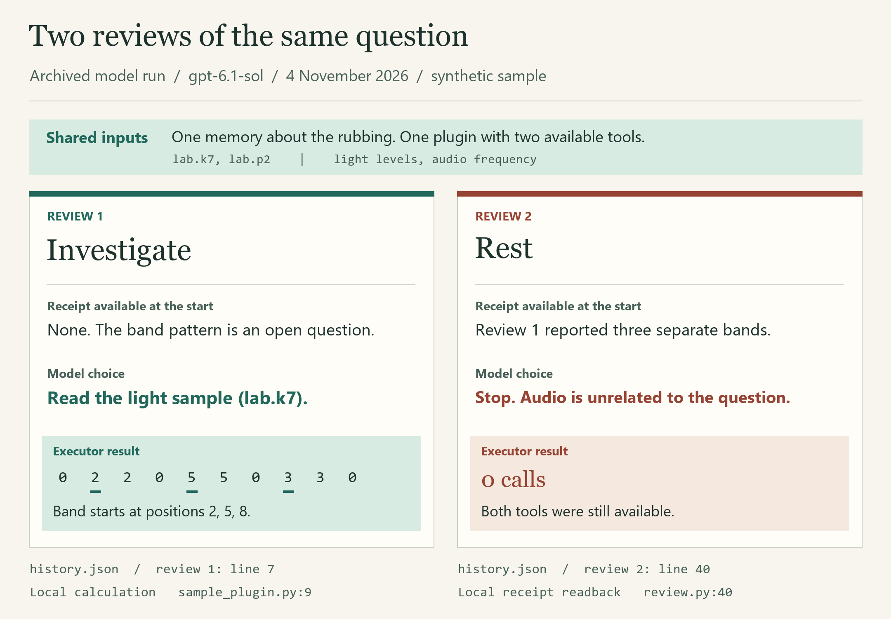
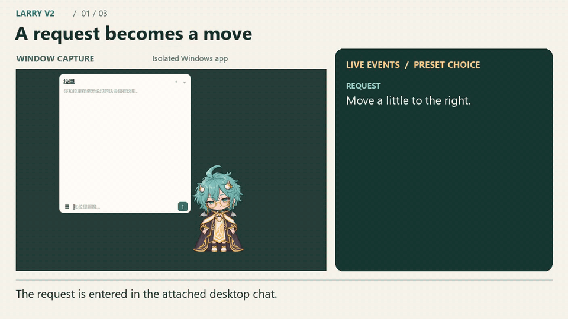
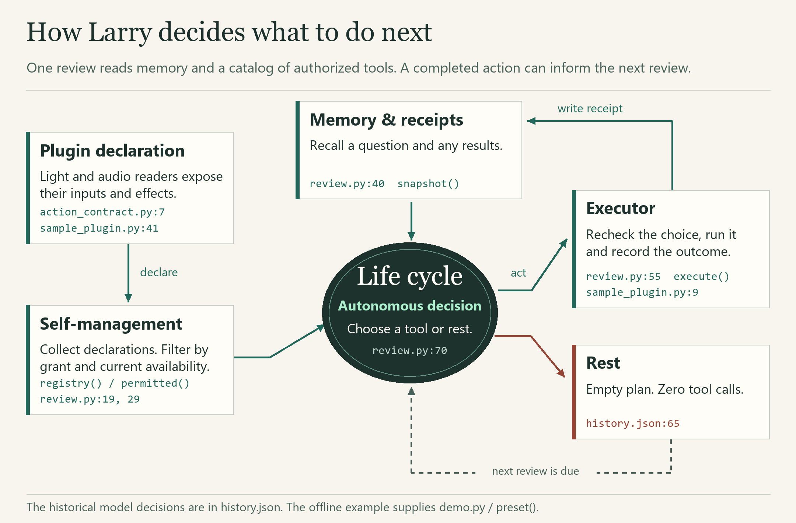

# Larry V2 · A memory-driven desktop companion

English · [日本語](README.ja.md) · [简体中文](README.zh-CN.md)

Larry is a Windows desktop companion who can pick up an unresolved question after a conversation ends and use what she finds to decide when to stop. I designed her decision loop around shared memory and the capabilities each plugin declares.

**Two tools, one call, then none.** In a recorded model experiment, Larry chose the light reader to investigate a paper rubbing. At the next review, the same two tools were available. The receipt already showed three separate bright bands, and she chose to rest. [Archived decisions](history.json)



<details>
<summary>Inspect the two recorded choices, the original Chinese and the sample calculation</summary>

## Why Larry stopped

On **4 November 2026**, a real model (`gpt-6.1-sol`) received this fictional memory. The experimenter installed one plugin, granted both operations and determined when the two reviews came due. No user message assigned Larry the task. [Archived experiment](history.json)

> 刚揭下一张窗花拓片，肉眼分不清纸上的亮带是连成一片还是分开的。我还挺好奇的。
>
> “I just lifted a rubbing from a paper-cut window decoration. I can’t tell by eye whether the bright bands run together or are separate. I’m curious.”

| Review | The model’s recorded choice and reason |
| --- | --- |
| **1 · Read the light sample** | 刚揭下的窗花拓片上，亮带是否连成一片还看不清；读取本地透光样本的亮暗分布，值得用来进一步判断。<br>“I still can’t tell whether the bright bands on the rubbing run together. Reading the light and dark pattern in the local sample should help me tell.” |
| **2 · Rest** | 已有真实读数确认拓片上有3段分离的亮带，当前好奇点已得到解答，无需重复读取；音频样本与当前兴趣无关，先休息。<br>“The readings confirm three separate bright bands. That answers my question, so there’s no need to read it again. The audio sample is unrelated to what I’m curious about, so I’ll rest for now.” |

The executor read `0 2 2 0 5 5 0 3 3 0`. A band starts at the first positive value after a zero, or at the first sample if it is positive. Counting from one gives starts at **2, 5 and 8**. You can follow those ten values from the returned receipt into the second review’s input. The second review made **zero** tool calls. This record lets you inspect a single model choice and its follow-up. [Calculation](sample_plugin.py#L9) · [Returned receipt](history.json#L35) · [Receipt in the next review](history.json#L62)

</details>

## Three moments on the desktop

Watch the character on the left and the evidence behind each action on the right. The first clip captures an isolated Windows run. In the other two, the decisions are historical and the character poses are reenacted for this guide.



| Clip | What to watch |
| --- | --- |
| [01 · Move](media/01-move.mp4) | 11 s · A user asks Larry to move. A preset selects the step. The pet and open chat panel move together, and the window reports the measured landing. |
| [02 · Plan](media/02-plan.mp4) | 10 s · An archived model run. The memory raises a question about light. Larry sees two readers and makes a concrete plan to use one. |
| [03 · Browse and share](media/03-share.mp4) | 12 s · A redacted activity replay. With an earlier preference for more sharing, Larry reads 48 subtitle excerpts. In the following review she chooses to share. QQ confirms acceptance. The recipient’s read status is unknown. |

## The life cycle

A message can start a conversation. A scheduled review gives Larry another chance to act even if no message arrives. Both obtain capabilities through **self-management**. The plugin that owns an action describes its inputs, availability and effect once. The model decides whether that effect would be useful in light of the current memory. This is how an unfamiliar tool can become a candidate without adding its name to the decision loop.

The diagram follows one cycle from remembered experience to an executable choice and back to memory.



| Follow one review in the public source | What to look for |
| --- | --- |
| 1. A plugin registers two operations. | Both have the label “read sample” and opaque IDs. Their descriptions distinguish light intensity from sound frequency. Each has its own argument check and executable function. [Contract](action_contract.py#L7) · [Declarations](sample_plugin.py#L41) |
| 2. Self-management builds the current catalog. | The registry gathers operations from installed providers. The snapshot includes the memory, prior receipts and operations that pass the grant and availability checks. Being available puts the audio reader on the menu even when it is irrelevant to this question. [Registry and eligibility](review.py#L19) · [Snapshot](review.py#L40) |
| 3. A decision becomes an action or a rest. | The decision-maker receives that snapshot. For each selected step, the executor checks the catalog again and validates the arguments. An empty plan finishes the review with zero tool calls. [Review loop](review.py#L70) · [Execution](review.py#L55) |
| 4. The result becomes evidence for the next review. | SQLite records which operation ran, its state and its returned text. A later snapshot reads that row back. In this example, an unknown outcome also prevents the same operation from being offered again. [Receipt write](review.py#L84) · [Next snapshot](review.py#L40) |

**Adding a capability.** To experiment in a local copy, add an operation to the sample provider, give it a description and handler, and add its ID to the demo grants. It will appear in the printed catalog. The offline chooser will keep making its preset selection; the catalog and the chooser are separate pieces you can inspect. [Provider](sample_plugin.py#L41) · [Grants and preset](demo.py#L14)

**What you can run here.** This public repository contains a self-contained Python example of the decision loop, two diagrams and the archived model run. The desktop application and its account-connected integrations are described below. The commands run the example locally with Python 3.10+ and its standard library. [Run the example](#run-the-example) · [Explore the architecture](#the-life-cycle) · [Compare the two reviews](#why-larry-stopped)

## Run the example

```sh
git clone https://github.com/tiantongwang-wtt/larry-v2.git
cd larry-v2
python demo.py offline
python demo.py history
```

After cloning, both commands work offline without an account, API key or additional packages. The terminal preserves the original Chinese text. The figures and translations above follow the same two reviews.

| Command | Where the choices and results come from |
| --- | --- |
| `python demo.py offline` | A preset chooses the light reader on the first review. The local executor counts the bands, writes a receipt to an in-memory SQLite database and the second review reads it. [Preset](demo.py#L17) · [Offline entry point](demo.py#L49) |
| `python demo.py history` | Reads the archived inputs, choices and receipts from JSON. It makes no new model or tool call. [Replay entry point](demo.py#L59) · [Original record](history.json) |

**Try changing the evidence.** In a local copy, change the fourth sample value from `0` to `1`. Two adjacent bands merge. Run both commands again. The offline result and its next review now say **two bands**; the historical replay still says **three**. [Sample values](sample_plugin.py#L6)

## Living with Larry

| At rest | Holding a book | Thinking |
| :---: | :---: | :---: |
|  |  |  |

*Three frames from the running Windows character in an isolated instance. A reading pose is a visible gesture. What Larry actually read is recorded separately by the tool that opened the material.*

| In the running companion | What happens |
| --- | --- |
| Continue a conversation from another place | A thought can start in the desktop chat and continue in QQ. Both use shared memory. Each message keeps its source and time, so Larry can tell where something was said or corrected. |
| Return to a subject on her own | A review can come due while nobody is typing. Larry can recall a loose end, consult an available source, contact the user or let the subject rest. She can also choose when it is worth looking again. |
| Look more closely at something | Larry can open a Bilibili video at a chosen interval, inspect frames and available subtitles, or read a HeyBox (小黑盒) post and its images. The asset library lets her revisit saved material. A short excerpt stays identifiable as an excerpt when she discusses it later. |
| Show what she is doing | A book or a thinking pose can accompany an activity. Larry can also use a gesture as her reply, hold it while chatting, or walk or fly across the desktop. An open chat panel travels with her. If the user starts composing a message, the window stays put. |
| Find out what actually happened | The activity view shows the current activity, the last recorded decision and the next review time. An executor’s receipt distinguishes a completed action, a failure and an unknown outcome. A platform accepting a message and its recipient seeing it are separate observations. |

Larry also keeps an asset library for images, documents and her own stickers. That gives a conversation a way back to the material behind a memory. For example, she can look up a saved image and choose whether to send it with a reply. Web search, Bilibili and HeyBox offer different sources when something needs checking.
