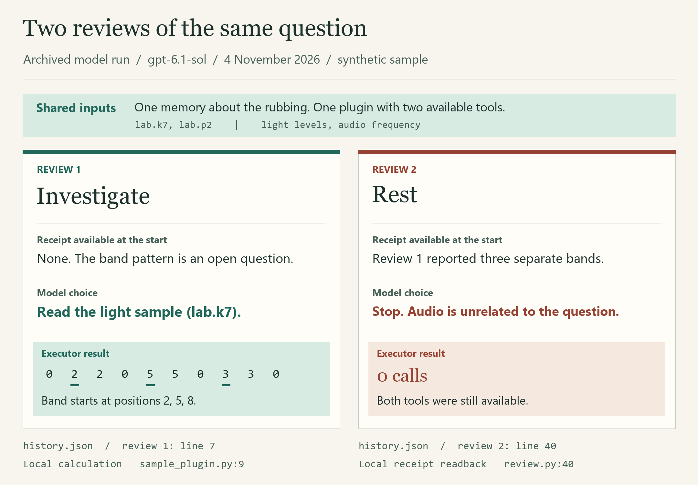
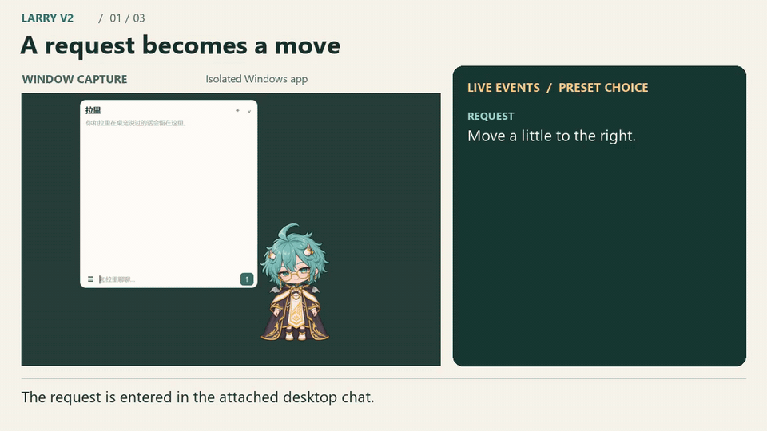
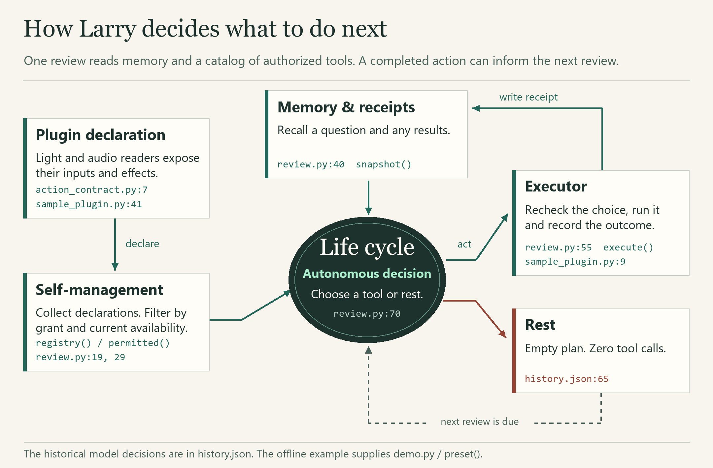

# 拉里 V2 · 根据记忆自主行动的桌面伙伴

[English](README.md) · [日本語](README.ja.md) · 简体中文

拉里是一个 Windows 桌面伙伴。对话结束后，她仍能想起一个没弄明白的问题，自己选工具查证，再根据结果决定什么时候停下来。我设计这套决策循环时，让她从共同记忆里找线索，从各插件的能力声明里找可用的工具。

**第一轮调用一次，第二轮零次。** 在一次模型实验里，拉里想知道窗花拓片上的亮带是否相连，选了测光。下一轮透光和音频工具都还能用，但回执已经给出三段分离的亮带，她决定休息。 [历史决策记录](history.json)



<details>
<summary>查看两轮选择的中文原话和亮带计算</summary>

## 为什么第二轮选择休息

**2026 年 11 月 4 日**，真实模型 `gpt-6.1-sol` 收到了下面这条虚构记忆。实验者安装了一个插件，授权两项能力，并安排两轮依次到期。现场没有主人来信交办调查任务。[历史实验记录](history.json)

> 刚揭下一张窗花拓片，肉眼分不清纸上的亮带是连成一片还是分开的。我还挺好奇的。

| 历史选择 | 模型当时给出的理由（原文） |
| --- | --- |
| **第一轮 · 读取透光样本** | 刚揭下的窗花拓片上，亮带是否连成一片还看不清；读取本地透光样本的亮暗分布，值得用来进一步判断。 |
| **第二轮 · 休息** | 已有真实读数确认拓片上有3段分离的亮带，当前好奇点已得到解答，无需重复读取；音频样本与当前兴趣无关，先休息。 |

执行器沿截面读到 `0 2 2 0 5 5 0 3 3 0`。从零变正，或首个读数就是正数，便记为一段亮带的开头。从 1 开始编号，起点落在第 **2、5、8** 个位置。这十个读数从第一轮回执原样进入了第二轮输入，第二轮的工具调用为 **0 次**。这份记录能供人逐步核对一次选择，尚不足以估计模型在其他情境下选对的比例。[计算函数](sample_plugin.py#L9) · [执行器返回的读数](history.json#L35) · [下一轮收到的回执](history.json#L62)

</details>

## 桌面上的三个片段

左边看桌宠，右边看这一步依据什么、选了什么、实际得到了什么。第一段录自隔离 Windows 桌宠。后两段按历史记录回放，角色姿态用当前桌宠重演。三段都附英文字幕。



| 片段 | 看点 |
| --- | --- |
| [01 · 挪一下](media/01-move.mp4) | 11 秒。主人提出移动请求，预设选择横移。桌宠带着展开的聊天框走到新位置，窗口回报实际落点。 |
| [02 · 想一件事，形成计划](media/02-plan.mp4) | 10 秒。回放真实模型在窗花实验中的决定。先看到记忆里的疑问，再看到两个可选工具，最后选定测光。 |
| [03 · 浏览后主动分享](media/03-share.mp4) | 12 秒。回放脱敏后的真实活动。此前主人希望更常收到分享；拉里读到 48 条视频字幕节选，下一轮自行选择分享。QQ 已受理，收件人已读情况未知。 |

## 生命循环

来信可以开启一轮对话，即使没有来信，拉里也有下一次自主判断的机会。两种入口都向**自我管理模块**取得能力目录。插件只需声明一次自己的输入、可用条件和实际效果。至于这项能力对眼前的疑问有没有用，交给模型结合记忆判断。因此，新工具接入时，决策循环里无需再补一条认识它名字的规则。

下图从生命循环出发，沿着记忆、插件声明和执行器，追到下一轮能看到的回执。



| 顺着公开源码看一轮复核 | 值得看的细节 |
| --- | --- |
| 1. 一个插件声明两项能力 | 两项的标签都叫“样本读取”，光看标识也猜不出用途。说明才告诉模型，一项能测明暗分布，另一项能测声音频率。每项都提供参数校验和执行函数。[声明类型](action_contract.py#L7) · [两项声明](sample_plugin.py#L41) |
| 2. 自我管理汇总本轮目录 | 先收集已接入插件的声明，再按授权和当前条件筛选。记忆、以往回执和当下能用的能力一起交给决策端。即便她在意的是光，音频工具只要可用也会出现在目录里。[收集与筛选](review.py#L19) · [本轮快照](review.py#L40) |
| 3. 选择行动，或者休息 | 选了操作，执行前还要再查一次目录并校验参数。给出空计划，这一轮便以零次工具调用结束。[决策循环](review.py#L70) · [实际执行](review.py#L55) |
| 4. 上轮结果成为下轮依据 | SQLite 记下哪项操作运行过、状态是什么、返回了什么。下一轮读回这条记录。这个案例还会将结果未知的同一操作从可用目录中排除，防止重复执行。[写入回执](review.py#L84) · [下轮读回](review.py#L40) |

**怎样加一项能力？** 可以在本地副本的样本插件里新增一项操作，写好说明和执行函数，再把标识加入演示授权列表。重新运行，就能在打印的目录里找到它。离线版依然按预设选透光，读者可以分别检查“能看到哪些选项”和“最终怎么选”。[插件入口](sample_plugin.py#L41) · [授权和离线预设](demo.py#L14)

**这个仓库可以直接运行什么？** 这里公开了从拉里身上提取的 Python 决策案例、两张技术图，以及一次真实模型的历史记录。下文也介绍带桌宠和账号联动的运行版。要在本机复现案例，只需 Python 3.10 或更新版本的标准库。[在本机运行](#在本机运行) · [看生命循环](#生命循环) · [对照两轮决策](#为什么第二轮选择休息)

## 在本机运行

```sh
git clone https://github.com/tiantongwang-wtt/larry-v2.git
cd larry-v2
python demo.py offline
python demo.py history
```

下载仓库后，两个命令都可离线运行，无需账号、API 密钥或额外依赖。

| 命令 | 选择和结果从哪里来 |
| --- | --- |
| `python demo.py offline` | 按明示的预设选择透光。本地执行器实际计算亮带，结果写入内存中的 SQLite，第二轮再从数据库读回。[离线预设](demo.py#L17) · [运行入口](demo.py#L49) |
| `python demo.py history` | 从 JSON 读取历史模型当时的输入、选择和回执。这一路只读记录，不会重新调用模型或执行工具。[回放入口](demo.py#L59) · [原始记录](history.json) |

**亲手改一次证据。** 在自己的副本里把第 4 个样本值从 `0` 改为 `1`，原先相隔的前两段就连起来了。再运行这两个命令，离线版的计算结果和下一轮读到的回执都变成**两段**，历史回放里仍是当时记录的**三段**。[样本读数](sample_plugin.py#L6)

## 平常怎样和拉里相处

| 常态 | 捧书 | 沉思 |
| :---: | :---: | :---: |
|  |  |  |

*三张图截自实际运行的 Windows 隔离桌宠。捧书是屏幕上的姿态。她读到了哪份材料、读到哪里，由打开材料的工具另行记录。*

| 运行版里的体验 | 实际会发生什么 |
| --- | --- |
| 换个地方接着聊 | 可以在桌宠提起一个话题，回到 QQ 接着问。两边看的是同一套记忆，原话保留来源和时间。后来改了主意，也能知道先说了什么、又在哪里改了口。 |
| 没人提问，也能想起一件事 | 到了她安排的复核时刻，拉里可以想起上次没弄明白的问题，自行找资料、联系主人，或者先放一放。她也可以决定什么时候值得回来再想。 |
| 遇到有意思的材料，多看一点 | 拉里可以在 B 站视频中选一个时间段，看画面和当时能取得的字幕；也可以读小黑盒帖子的正文和配图。保存过的材料可以从资产库找回来。如果只读了一个片段，后来谈起它时仍能说清依据来自哪一段。 |
| 用动作回应 | 阅读和思考时可以带上相应姿态，拉里也能直接用动作回答你、捧着书继续聊天，或走到、飞到桌面另一处。展开的聊天框会跟着她走；你开始打字，她就停在当时的位置。 |
| 回头看刚才做了什么 | 自主生活观察页显示当前活动、上轮判断和下次复核时间。执行记录区分完成、失败和结果未知。平台受理了一条消息，与收件人确认看到它，各有各的依据。 |

拉里还有自己的资产库，保存图片、文档和原创表情。比如聊起以前看过的图，她可以找回那张图，自己决定要不要随回复发给你。如果还有疑问，也可以从网页检索、B 站和小黑盒里选合适的来源补查。
